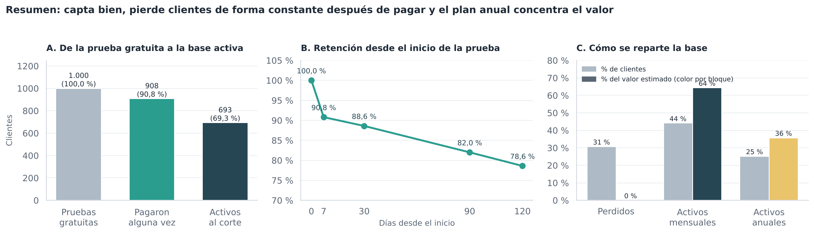
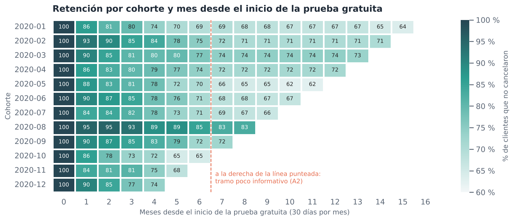
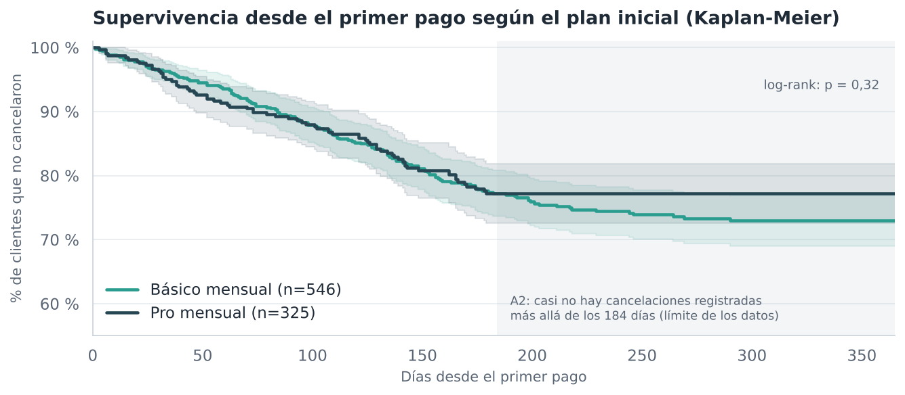
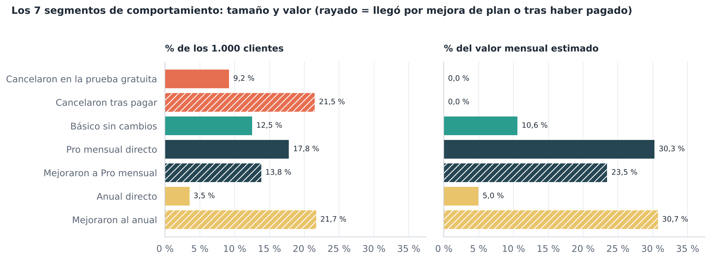
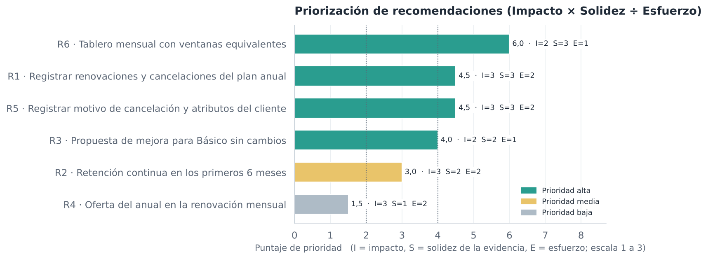

# Foodie-Fi · Análisis de clientes de un servicio de suscripción

Proyecto de **Data Analytics en Python** (pandas, NumPy, SciPy, matplotlib, seaborn, Jupyter) que analiza el ciclo de vida de los clientes de un servicio de streaming por suscripción:
**conversión, cohortes, retención, cancelación y segmentación**, con recomendaciones de negocio priorizadas y honestas sobre lo que los datos permiten (y no permiten) afirmar.

> **Dataset sintético** (*8-Week SQL Challenge, Case Study #3*): el proyecto muestra método y criterio analítico, no resultados de un negocio real.

**📓 Ver los análisis:** [01 Limpieza y validación](notebooks/01_data_loading_cleaning_validation.ipynb) ·
[02 Embudo y comportamiento](notebooks/02_eda_funnel_and_behavior.ipynb) ·
[03 Cohortes y retención](notebooks/03_cohorts_retention_churn.ipynb) ·
[04 Segmentación](notebooks/04_customer_segmentation.ipynb) ·
[05 Conclusiones y recomendaciones](notebooks/05_insights_and_recommendations.ipynb)



## Qué demuestra este proyecto

| Habilidad | Dónde verla |
|---|---|
| Limpieza y validación de datos con controles independientes (hashes, reglas de negocio, doble verificación) | Notebook 01 |
| EDA y análisis de embudo, con tests estadísticos y sin sobreinterpretar el azar | Notebook 02 |
| Cohortes, retención y curvas de supervivencia (Kaplan-Meier, log-rank), controlando censura y sesgo de supervivencia | Notebook 03 |
| Segmentación conductual verificada por dos métodos y análisis económico con supuestos explícitos | Notebook 04 |
| Síntesis ejecutiva, priorización (impacto × solidez ÷ esfuerzo), KPIs y diseño de experimentos | Notebook 05 |
| Comunicación honesta: se reportan diferencias que **no** resisten un test y los límites de los datos | Todos |

## Caso de negocio

Foodie-Fi ofrece una **prueba gratuita de 7 días** y luego tres planes: **Básico mensual**, **Pro mensual** y **Pro anual**. Las preguntas que guían el análisis:

1. ¿Qué proporción de las pruebas gratuitas se convierte en clientes de pago y a qué plan?
2. ¿Cómo evoluciona la retención y cuándo cancelan los clientes?
3. ¿Hay diferencias entre planes o entre cohortes mensuales?
4. ¿Qué perfiles de comportamiento existen y cuánto valen?
5. ¿Qué acciones respaldan los datos y cuáles requieren mejores datos?

## Hallazgos principales

Cada cifra se calcula en los notebooks (ver `reports/metrics/`) y las afirmaciones sobre diferencias están protegidas por tests estadísticos y `assert`.

1. **La entrada funciona.** 908 de 1.000 pruebas gratuitas (90,8 %) pasan a un plan de pago, sin diferencias entre meses (p = 0,73).
2. **El problema es posterior a la conversión.** El 70 % de las cancelaciones ocurre después de haber pagado; a los 90 días sigue activo el 82,0 % de los clientes y a los 120 días el 78,6 %.
3. **El riesgo es constante y parejo.** La cancelación en planes mensuales ronda el 4,2 % cada 30 días (3,6 %–5,4 %), sin etapa crítica y **sin diferencias entre Básico y Pro mensual** (tres métodos: razón de tasas 1,05 con p = 0,78; Fisher p = 0,93; log-rank p = 0,32) **ni entre cohortes** (p = 0,19 a 90 días).
4. **Los clientes crecen mejorando de plan.** Hay 435 mejoras de plan frente a 209 cancelaciones desde planes mensuales; el 63 % de quienes empiezan en Básico mensual mejora de plan en 184 días, y el 97,3 % de los pasajes de Pro mensual a anual ocurre en la fecha de renovación mensual.
5. **El plan anual pesa y no se puede medir.** Reúne el 36,4 % de la base activa y el 35,7 % del valor estimado, pero su renovación queda **entre 0 % y 76 %** según el supuesto. A precio de lista equivale a un descuento mensual del 16,7 %: se justifica por el compromiso, no por el precio.
6. **La base se reparte en siete perfiles de comportamiento** (30,7 % perdidos, 44,1 % activos mensuales, 25,2 % activos anuales); los perfiles no se explican por antigüedad ni por cohorte.







## Recomendaciones priorizadas

Puntajes cualitativos de 1 a 3 asignados por el analista. **Prioridad = Impacto × Solidez de la evidencia ÷ Esfuerzo** (Alta ≥ 4, Media 2–4, Baja < 2).

| # | Recomendación | Tipo | Prioridad |
|---|---|---|---|
| R6 | Tablero mensual con ventanas equivalentes y pruebas estadísticas | Seguimiento | Alta |
| R1 | Registrar renovaciones y cancelaciones del plan anual como eventos | Datos | Alta |
| R5 | Registrar el motivo de cancelación y atributos básicos del cliente | Datos | Alta |
| R3 | Probar una propuesta de mejora para los clientes que se quedaron en Básico mensual (con grupo de control) | Acción comercial | Alta |
| R2 | Retención continua durante los primeros 6 meses de un plan mensual, igual para Básico y Pro | Acción comercial | Media |
| R4 | Evaluar la oferta del anual en la renovación mensual (condicionada a R1) | Acción comercial | Baja |

Ser de prioridad "Media" o "Baja" no significa que sea poco importante: **R2 es el frente de mayor impacto** pero requiere diseño y prueba, y **R4 depende de poder medir la renovación anual (R1)**.
Detalle completo, métricas a monitorear y diseño de experimentos en el [notebook 05](notebooks/05_insights_and_recommendations.ipynb).



## Decisiones metodológicas destacadas

- **No se declaran hallazgos sin test.** Varias diferencias "llamativas" (por ejemplo, la cohorte con mejor y peor retención a 90 días: 93,2 % frente a 73,4 %) no son estadísticamente distinguibles del azar y se reportan como tales.
- **Ventanas equivalentes.** Las cohortes se comparan sólo en plazos que todas pueden haber alcanzado. Los clientes "observables" se definen por el tiempo potencial de observación, no por el tiempo hasta cancelar (evita el sesgo de supervivencia).
- **Una única fuente de verdad.** Cada notebook guarda sus cifras en `reports/metrics/*.json` y el notebook 05 las lee; además verifica que sean consistentes entre sí antes de escribir conclusiones.
- **Verificaciones cruzadas.** Los datos reproducen las cifras del caso de estudio publicado; los segmentos se asignan por dos métodos independientes; las funciones estadísticas se prueban contra casos calculados a mano.
- **Sensibilidad a los supuestos.** Los dos supuestos principales (A1 y A2, abajo) se documentan y se mide cuánto cambian los resultados.

## Datos y limitaciones

- **Dataset sintético:** no representa un negocio real; las conclusiones no son generalizables.
- **A2 · Tope temporal:** en planes mensuales ningún evento ocurre pasados 184 días del inicio del plan, por lo que la retención de largo plazo **no es informativa** y no debe extrapolarse más allá de ~6 meses.
- **A1 · Renovación anual:** 19 de 25 planes anuales ya vencidos al corte no registran ningún evento posterior; se tratan como renovados y se mide el efecto de lo contrario (los resultados globales casi no cambian, pero la retención del anual queda indeterminada).
- **Sin variables de perfil:** no hay país, canal ni uso del servicio; la segmentación es conductual.
- **Ingresos estimados:** precio de lista (moneda no especificada), no pagos reales.
- **Censura:** las cohortes tienen ventanas de seguimiento distintas (el corte de observación es el 30-abr-2021).
- **Asociación, no causalidad:** los datos son observacionales.
- Detalle en [`data/README.md`](data/README.md) y en cada notebook.

## Estructura del repositorio

```
foodie-fi-subscription-analytics/
├── README.md
├── requirements.txt
├── data/
│   ├── README.md                 # procedencia y diccionario de datos
│   ├── raw/                      # originales (solo lectura): plans.csv, subscriptions.csv
│   └── processed/                # datasets limpios generados por el notebook 01
├── notebooks/                    # 01 a 05, numerados, con resultados guardados
├── reports/
│   ├── figures/                  # gráficos exportados (PNG)
│   ├── metrics/                  # cifras clave de cada etapa (JSON)
│   └── recomendaciones_priorizadas.csv
├── docs/                         # notebooks exportados a HTML 
├── src/
│   └── plot_style.py             # paleta, nombres y formato de números
└── scripts/
    ├── extract_raw_data.py       # reconstruye data/raw/ desde el SQL original
    └── export_html.py            # exporta los notebooks a docs/
```

## Cómo reproducirlo

```bash
python -m venv .venv && source .venv/bin/activate     # en Windows: .venv\Scripts\activate
pip install -r requirements.txt
python scripts/extract_raw_data.py                    # opcional: regenera data/raw/ desde la fuente
jupyter lab notebooks/                                # ejecutar los notebooks en orden (01 → 05)
python scripts/export_html.py                         # opcional: actualiza la versión web en docs/
```

Los notebooks deben ejecutarse **en orden**: el 05 lee las métricas que guardan el 02, el 03 y el 04. Probado con pandas 2.2.3 y 3.0.6 (resultados idénticos).

## Glosario

Los datos conservan los nombres originales en inglés; en gráficos, tablas y textos se muestran en español.

| En los datos | En este análisis |
|---|---|
| `trial` | Prueba gratuita (7 días) |
| `basic monthly` | Básico mensual |
| `pro monthly` | Pro mensual |
| `pro annual` | Pro anual |
| `churn` | Cancelación |
| *upgrade* | Mejora de plan (pasar a un plan de mayor nivel) |
| *cohorte* | Clientes agrupados por el mes en que empezaron su prueba gratuita |

## Stack
Python · pandas · NumPy · SciPy · matplotlib · seaborn · Jupyter

## Autor
**Melisa Rossi** · [LinkedIn](https://www.linkedin.com/in/melirossi) · [GitHub](https://github.com/MelRossi)
